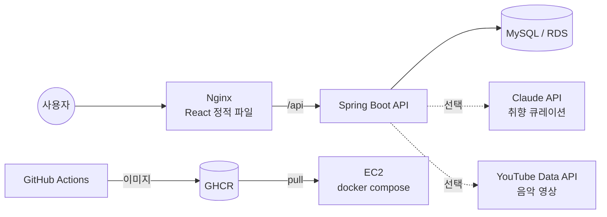
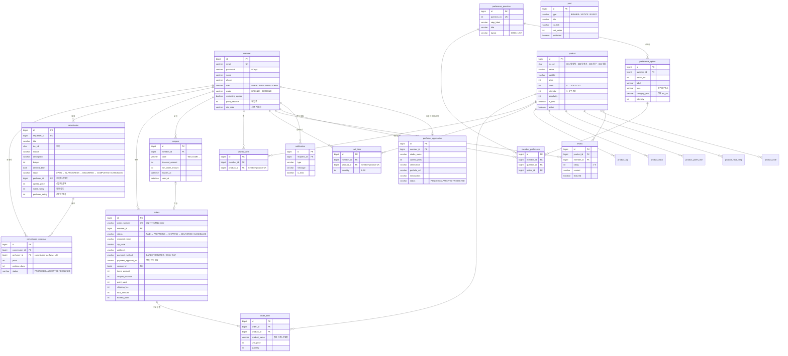
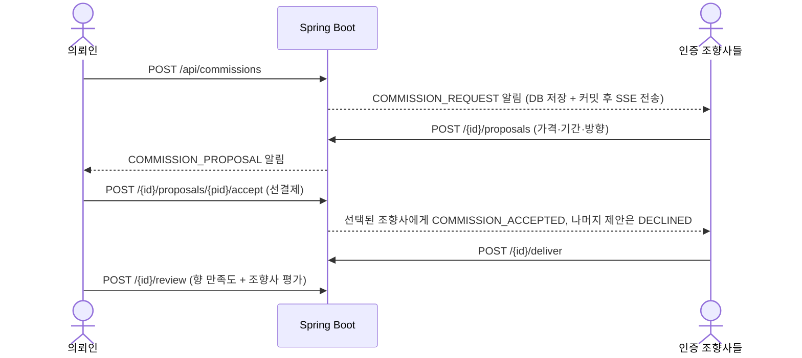

# 여운 — 설계 문서

## 시스템 구성

## ERD

## 취향 추천 로직

1. 6개 질문의 선택지마다 **향 계열 태그**(WOODY, GREEN, CITRUS …), **선호 향 종류**(사용 장면 질문), **무게감**(잔향 질문)을 저장해 둡니다.
2. 회원의 답변을 모아 `ScentProfile`(태그 가중치 · 선호 카테고리 · 무게감)을 만듭니다.
3. 상품 점수 = Σ(상품 태그 × 가중치 × 3) + 선호 카테고리 일치 6점 + 무게감 근접도(최대 4점), 동점은 인기도 순.
4. 상위 4개를 추천하고, `ANTHROPIC_API_KEY`가 있으면 Claude가 답변·키워드·추천 상품을 바탕으로 큐레이션 문장을 씁니다. 실패하거나 키가 없으면 규칙 기반 문장으로 대체합니다.
5. 메인 페이지는 `/api/preferences/me`(AI 호출 없음)로 맞춤 추천을 받아 히어로 바로 아래에 보여 줍니다.

## 주문 · 결제 흐름

1. 주문서 제출 → 상품을 `SELECT … FOR UPDATE`(비관적 잠금)로 읽어 재고 확인·차감 (동시 주문 시 초과 판매 방지)
2. 쿠폰 사용(본인·기간·최소 금액 검증) → 적립금 차감 → 배송비(5만원 이상 무료) 계산
3. `MockPaymentGateway`가 승인 번호 발급 → 주문 저장, 장바구니 정리, 알림 발송 — 모두 한 트랜잭션
4. 취소 시 재고·쿠폰·적립금을 되돌리고, 배송 완료 시 1% 적립 + 누적 금액으로 등급 상향

## 커미션 · 실시간 알림

알림은 `NotificationService`가 저장과 동시에 이벤트를 발행하고, `@TransactionalEventListener`가 **커밋 이후에만** `SseEmitter`로 전송합니다. 브라우저는 `EventSource` 대신 fetch 스트림을 사용해 `Authorization` 헤더를 실어 보내며, Nginx는 해당 경로의 버퍼링을 끕니다.

## 주요 API

| Method | Path | 권한 | 설명 |
| --- | --- | --- | --- |
| POST | /api/auth/signup | - | 회원가입 (조향사 신청 포함) |
| POST | /api/auth/login | - | 로그인 → JWT |
| GET | /api/members/me | 회원 | 내 정보 |
| GET | /api/products | - | 목록 (category, keyword, feeling, scene, minPrice, maxPrice, sort, page, size) |
| GET | /api/products/{id} | - | 상세 |
| GET | /api/products/popular · /new | - | 메인 인기 · 신상품 |
| GET | /api/categories/{slug}/filters | - | 카테고리 필터 값 |
| GET/POST | /api/products/{id}/reviews | -/회원 | 리뷰 목록 / 작성 |
| GET | /api/reviews/featured | - | 메인 후기 |
| GET | /api/posts?type=BANNER | - | 메인 배너 |
| GET | /api/preferences/questions | - | 향 찾기 질문 |
| POST | /api/preferences | 회원 | 답변 저장 + 추천 |
| GET | /api/preferences/me | 회원 | 내 추천 (없으면 204) |
| GET | /api/music/youtube?q= | - | 트랙 → YouTube 영상 |
| GET/PATCH | /api/notifications… | 회원 | 알림 목록·읽음 처리 |
| GET | /api/notifications/stream | 회원 | 실시간 알림 (SSE) |
| GET/POST/PATCH/DELETE | /api/cart, /api/cart/items… | 회원 | 장바구니 |
| GET/PUT/DELETE | /api/wishlist… | 회원 | 찜한 향 |
| GET | /api/coupons/me | 회원 | 내 쿠폰 |
| POST/GET | /api/orders | 회원 | 주문(모의 결제) / 내 주문 목록 |
| GET/POST | /api/orders/{id}, /cancel | 회원 | 주문 상세 / 취소 |
| GET | /api/members/me/summary | 회원 | 마이페이지 요약 |
| PUT/PATCH | /api/members/me, /password, /address | 회원 | 회원정보·비밀번호·기본 배송지 |
| GET | /api/reviews/me | 회원 | 나의 의견 |
| GET | /api/commissions | - | 의뢰 게시판 |
| POST/GET | /api/commissions, /{id}, /me, /proposed | 회원 | 의뢰 등록·상세·내 의뢰·내 제안 |
| POST | /api/commissions/{id}/proposals, …/accept, /deliver, /review, /cancel | 조향사/의뢰인 | 제안 → 선결제 → 전달 → 후기 |
| GET/PATCH | /api/admin/orders… | 관리자 | 주문 목록·상태 변경 |
| * | /api/admin/products… | 관리자 | 상품 CRUD · 재고 |
| * | /api/admin/members… | 관리자 | 고객 목록 · 권한/등급 변경 |
| * | /api/admin/perfumer-applications… | 관리자 | 조향사 인증 승인/반려 |
| * | /api/admin/posts… | 관리자 | 배너·공지 게시글 CRUD |

전체 스펙은 백엔드 실행 후 `/api/docs`(Swagger UI)에서 확인할 수 있습니다.
