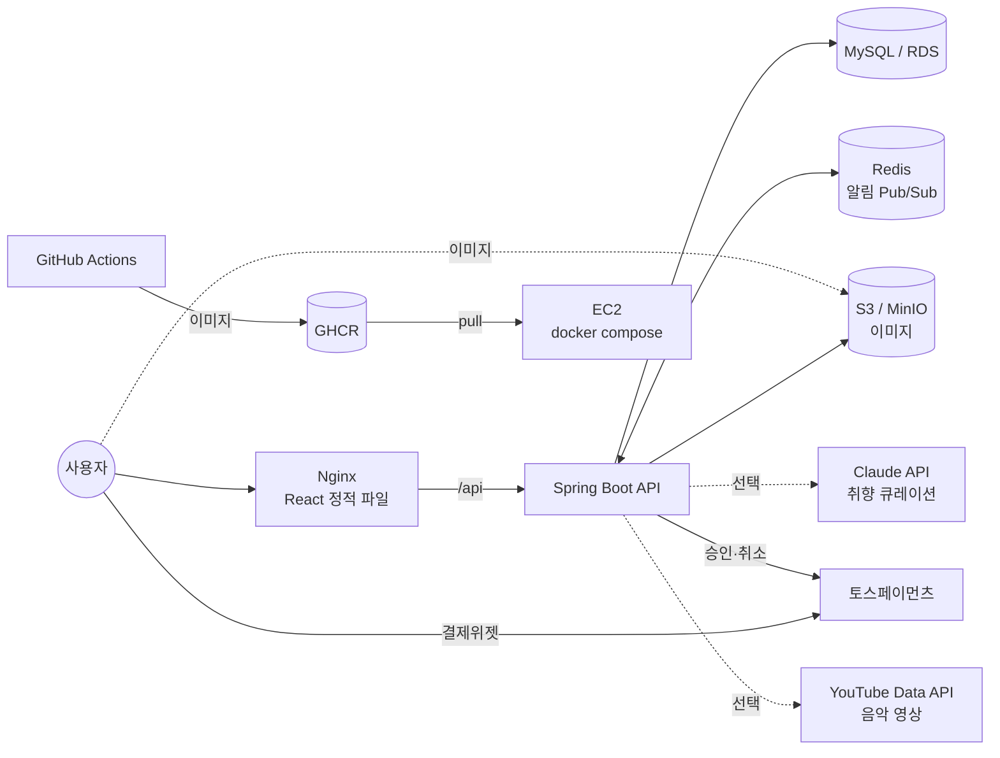
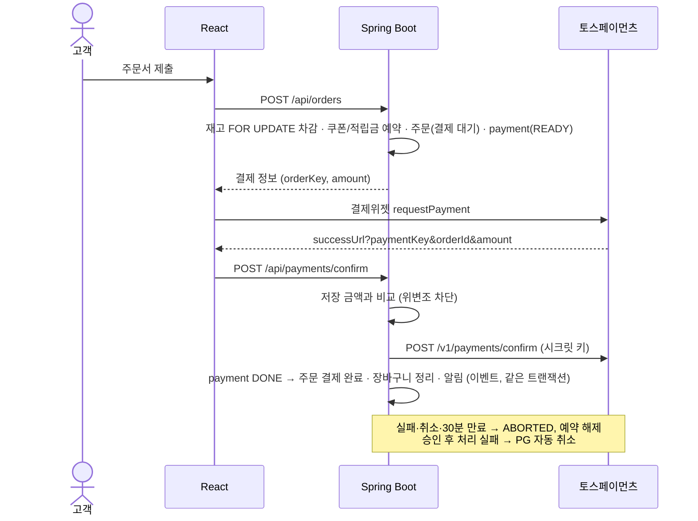
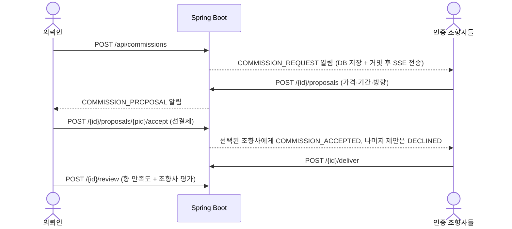

# 여운 — 설계 문서

## 시스템 구성

## ERD

```mermaid
erDiagram
  member ||--o| perfumer_application : "조향사 인증 신청"
  member ||--o{ notification : "받는 알림"
  member ||--o{ member_preference : "취향 답변"
  member ||--o{ review : "작성"
  preference_question ||--o{ preference_option : "선택지"
  preference_question ||--o{ member_preference : ""
  preference_option ||--o{ member_preference : ""
  product ||--o{ review : ""
  product ||--o{ product_note : ""
  product ||--o{ product_ritual_step : ""
  product ||--o{ product_poem_line : ""
  product ||--o{ product_track : ""
  product ||--o{ product_tag : ""
  member ||--o{ cart_item : "장바구니"
  product ||--o{ cart_item : ""
  member ||--o{ wishlist_item : "찜"
  product ||--o{ wishlist_item : ""
  member ||--o{ coupon : "보유"
  member ||--o{ orders : "주문"
  orders ||--|{ order_item : "주문 상품"
  product ||--o{ order_item : ""
  coupon |o--o| orders : "적용"
  member ||--o{ commission : "의뢰"
  commission ||--o{ commission_proposal : "제안"
  member ||--o{ commission_proposal : "조향사"
  member ||--o{ payment : "결제"
  commission ||--o| settlement : "정산"
  member ||--o{ settlement : "조향사"
  theme ||--o{ theme_product : "묶은 향"
  product ||--o{ theme_product : ""

  member {
    bigint id PK
    varchar email UK
    varchar password "BCrypt"
    varchar name
    varchar phone
    varchar role "USER / PERFUMER / ADMIN"
    varchar grade "BRONZE ~ DIAMOND"
    boolean marketing_agreed
    int point_balance "적립금"
    varchar zip_code "기본 배송지"
  }
  perfumer_application {
    bigint id PK
    bigint member_id FK
    varchar studio_name
    int career_years
    varchar certification
    varchar portfolio_url
    varchar introduction
    varchar status "PENDING / APPROVED / REJECTED"
  }
  product {
    bigint id PK
    char inc_cd "001 방향제 · 002 인센스 · 003 향수 · 004 캔들"
    varchar name
    varchar subtitle
    int price
    int stock "0 → SOLD OUT"
    int intensity "1~3 무게감"
    int popularity
    boolean is_new
    boolean active
  }
  preference_question {
    bigint id PK
    int question_no UK
    varchar step_label
    varchar title
    varchar layout "GRID / LIST"
  }
  preference_option {
    bigint id PK
    bigint question_id FK
    int option_no
    varchar label
    varchar tags "향 계열 태그"
    varchar category_hint "선호 inc_cd"
    int intensity
  }
  member_preference {
    bigint id PK
    bigint member_id FK
    bigint question_id FK
    bigint option_id FK
  }
  review {
    bigint id PK
    bigint product_id FK
    bigint member_id FK
    int rating "1~5"
    varchar content
    boolean featured
  }
  post {
    bigint id PK
    varchar type "BANNER / NOTICE / EVENT"
    varchar title
    varchar cta_link
    int sort_order
    boolean published
  }
  cart_item {
    bigint id PK
    bigint member_id FK
    bigint product_id FK "member+product UK"
    int quantity "1~10"
  }
  wishlist_item {
    bigint id PK
    bigint member_id FK
    bigint product_id FK "member+product UK"
  }
  coupon {
    bigint id PK
    bigint member_id FK
    varchar code "WELCOME ..."
    int discount_amount
    int min_order_amount
    datetime expires_at
    datetime used_at
  }
  orders {
    bigint id PK
    varchar order_number UK "YN-yyyyMMdd-####"
    bigint member_id FK
    varchar status "PAID → PREPARING → SHIPPING → DELIVERED / CANCELLED"
    varchar recipient_name
    varchar zip_code
    varchar address1
    varchar payment_method "CARD / TRANSFER / EASY_PAY"
    varchar payment_approval_no "모의 승인 번호"
    bigint coupon_id FK
    int items_amount
    int coupon_discount
    int point_used
    int shipping_fee
    int total_amount
    int earned_point
  }
  order_item {
    bigint id PK
    bigint order_id FK
    bigint product_id FK
    varchar product_name "주문 시점 스냅샷"
    int unit_price
    int quantity
  }
  commission {
    bigint id PK
    bigint requester_id FK
    varchar title
    char inc_cd "선택"
    varchar moods
    varchar description
    int budget
    date desired_date
    varchar status "OPEN → IN_PROGRESS → DELIVERED → COMPLETED / CANCELLED"
    bigint perfumer_id FK "선택된 조향사"
    int agreed_price "선결제 금액"
    int scent_rating "향 만족도"
    int perfumer_rating "조향사 평가"
  }
  commission_proposal {
    bigint id PK
    bigint commission_id FK
    bigint perfumer_id FK "commission+perfumer UK"
    int price
    int working_days
    varchar status "PROPOSED / ACCEPTED / DECLINED"
  }
  payment {
    bigint id PK
    bigint member_id FK
    varchar target_type "ORDER / COMMISSION"
    bigint target_id
    bigint target_ref "선택한 커미션 제안"
    varchar order_key UK "PG 주문 ID"
    varchar provider "TOSS / MOCK"
    int amount
    varchar status "READY → DONE → (PARTIAL_)CANCELED / ABORTED"
    varchar payment_key UK
    int canceled_amount
  }
  settlement {
    bigint id PK
    bigint commission_id FK
    bigint perfumer_id FK
    varchar reason "CONFIRMED / PARTIAL_CANCEL"
    int gross_amount
    int fee_amount "10%"
    int net_amount
    varchar status "PENDING / PAID"
  }
  theme {
    bigint id PK
    varchar slug UK
    varchar title
    varchar hero_image_url
    date starts_on
    date ends_on
    boolean published
  }
  theme_product {
    bigint id PK
    bigint theme_id FK
    bigint product_id FK
    int sort_order
    varchar note "큐레이터 한 줄"
  }
  notification {
    bigint id PK
    bigint recipient_id FK
    varchar type
    varchar message
    boolean is_read
  }
```

## 취향 추천 로직

1. 6개 질문의 선택지마다 **향 계열 태그**(WOODY, GREEN, CITRUS …), **선호 향 종류**(사용 장면 질문), **무게감**(잔향 질문)을 저장해 둡니다.
2. 회원의 답변을 모아 `ScentProfile`(태그 가중치 · 선호 카테고리 · 무게감)을 만듭니다.
3. 상품 점수 = Σ(상품 태그 × 가중치 × 3) + 선호 카테고리 일치 6점 + 무게감 근접도(최대 4점), 동점은 인기도 순.
4. 상위 4개를 추천하고, `ANTHROPIC_API_KEY`가 있으면 Claude가 답변·키워드·추천 상품을 바탕으로 큐레이션 문장을 씁니다. 실패하거나 키가 없으면 규칙 기반 문장으로 대체합니다.
5. 메인 페이지는 `/api/preferences/me`(AI 호출 없음)로 맞춤 추천을 받아 히어로 바로 아래에 보여 줍니다.

## 주문 · 결제 흐름 (토스페이먼츠)

- `PaymentService`는 주문·커미션을 직접 알지 않고 `PaymentEvents.Approved/Failed` 이벤트를 발행합니다. 주문·커미션 서비스가 같은 트랜잭션에서 받아 상태를 바꿉니다.
- 키가 없으면 `MockPaymentGateway`가 같은 경로로 즉시 승인하므로, 테스트와 로컬 개발이 PG 없이도 전체 흐름을 거칩니다.
- 취소 시 PG 환불 → 재고·쿠폰·적립금 복구, 배송 완료 시 1% 적립 + 누적 금액으로 등급 상향

## 커미션 정산 · 환불

| 단계 | 의뢰인 취소 시 환불 | 조향사 정산 |
| --- | --- | --- |
| 제안 받는 중 (결제 전) | - | - |
| 결제 완료 · 제작 대기 | 100% (조향사도 사양 가능) | 없음 |
| 제작 중 | 50% (PG 부분 취소) | 남은 50% − 수수료 10% |
| 전달 완료 | 불가 | 구매 확정(후기·직접 확정·7일 자동) 시 100% − 수수료 10% |

정산은 `PENDING` → 운영자 송금 확인 후 `PAID`. 수수료율·자동 확정 일수·제작 중 환불 비율은 `yeoun.commission.*` 설정값입니다.

## 커미션 · 실시간 알림

알림은 `NotificationService`가 저장과 동시에 이벤트를 발행하고, `NotificationRelay`(`@TransactionalEventListener`)가 **커밋 이후에만** 전송합니다. `REDIS_ENABLED=true`면 Redis 채널에 발행하고 모든 서버가 구독해 자기에게 연결된 사용자에게 `SseEmitter`로 보내므로, 서버를 여러 대로 늘려도 알림이 빠지지 않습니다(Redis 장애 시 로컬 전송으로 대체). 브라우저는 `EventSource` 대신 fetch 스트림을 사용해 `Authorization` 헤더를 실어 보내며, Nginx는 해당 경로의 버퍼링을 끕니다.

## 스키마 관리 (Flyway)

- `db/migration/common` : H2(테스트)·MySQL 공용. `V1__init_schema`(2단계까지), `V2__payment_settlement_theme`(3단계)
- `db/migration/mysql` : MySQL 전용. `V2_1__normalize_legacy_columns` — 예전 `ddl-auto=update`가 만든 enum 컬럼을 varchar로 정리
- `baseline-on-migrate: true`로 기존 DB는 V1을 기준선으로 등록하고 V2부터 적용
- `ddl-auto: validate`로 엔티티와 스키마가 다르면 기동 시 바로 실패 (CI 테스트에서 검출)

## 주요 API

| Method | Path | 권한 | 설명 |
| --- | --- | --- | --- |
| POST | /api/auth/signup | - | 회원가입 (조향사 신청 포함) |
| POST | /api/auth/login | - | 로그인 → JWT |
| GET | /api/members/me | 회원 | 내 정보 |
| GET | /api/products | - | 목록 (category, keyword, feeling, scene, minPrice, maxPrice, sort, page, size) |
| GET | /api/products/{id} | - | 상세 |
| GET | /api/products/popular · /new | - | 메인 인기 · 신상품 |
| GET | /api/categories/{slug}/filters | - | 카테고리 필터 값 |
| GET/POST | /api/products/{id}/reviews | -/회원 | 리뷰 목록 / 작성 |
| GET | /api/reviews/featured | - | 메인 후기 |
| GET | /api/posts?type=BANNER | - | 메인 배너 |
| GET | /api/preferences/questions | - | 향 찾기 질문 |
| POST | /api/preferences | 회원 | 답변 저장 + 추천 |
| GET | /api/preferences/me | 회원 | 내 추천 (없으면 204) |
| GET | /api/music/youtube?q= | - | 트랙 → YouTube 영상 |
| GET/PATCH | /api/notifications… | 회원 | 알림 목록·읽음 처리 |
| GET | /api/notifications/stream | 회원 | 실시간 알림 (SSE) |
| GET/POST/PATCH/DELETE | /api/cart, /api/cart/items… | 회원 | 장바구니 |
| GET/PUT/DELETE | /api/wishlist… | 회원 | 찜한 향 |
| GET | /api/coupons/me | 회원 | 내 쿠폰 |
| POST/GET | /api/orders | 회원 | 주문서 제출(결제 대기 + 결제 정보) / 내 주문 목록 |
| GET/POST | /api/orders/{id}, /cancel | 회원 | 주문 상세 / 취소 |
| GET | /api/members/me/summary | 회원 | 마이페이지 요약 |
| PUT/PATCH | /api/members/me, /password, /address | 회원 | 회원정보·비밀번호·기본 배송지 |
| GET | /api/reviews/me | 회원 | 나의 의견 |
| GET | /api/commissions | - | 의뢰 게시판 |
| POST/GET | /api/commissions, /{id}, /me, /proposed | 회원 | 의뢰 등록·상세·내 의뢰·내 제안 |
| POST | /api/commissions/{id}/proposals, …/accept, /deliver, /review, /cancel | 조향사/의뢰인 | 제안 → 선결제 → 전달 → 후기 |
| GET/PATCH | /api/admin/orders… | 관리자 | 주문 목록·상태 변경 |
| GET | /api/payments/config | - | 결제 방식(TOSS/MOCK)·위젯 키·customerKey |
| POST | /api/payments/confirm · /fail | 회원 | 결제 승인 / 결제창 실패 처리 |
| POST | /api/commissions/{id}/start · /confirm | 조향사/의뢰인 | 제작 시작 / 구매 확정 |
| GET | /api/settlements/me | 조향사 | 내 정산 |
| GET/POST | /api/admin/settlements… | 관리자 | 정산 목록 · 지급 완료 |
| GET | /api/themes · /{slug} | - | 테마 큐레이션 |
| * | /api/admin/themes… | 관리자 | 테마 CRUD |
| POST | /api/uploads?purpose= | 회원(상품·테마는 관리자) | 이미지 업로드 → URL |
| * | /api/admin/products… | 관리자 | 상품 CRUD · 재고 |
| * | /api/admin/members… | 관리자 | 고객 목록 · 권한/등급 변경 |
| * | /api/admin/perfumer-applications… | 관리자 | 조향사 인증 승인/반려 |
| * | /api/admin/posts… | 관리자 | 배너·공지 게시글 CRUD |

전체 스펙은 백엔드 실행 후 `/api/docs`(Swagger UI)에서 확인할 수 있습니다.
